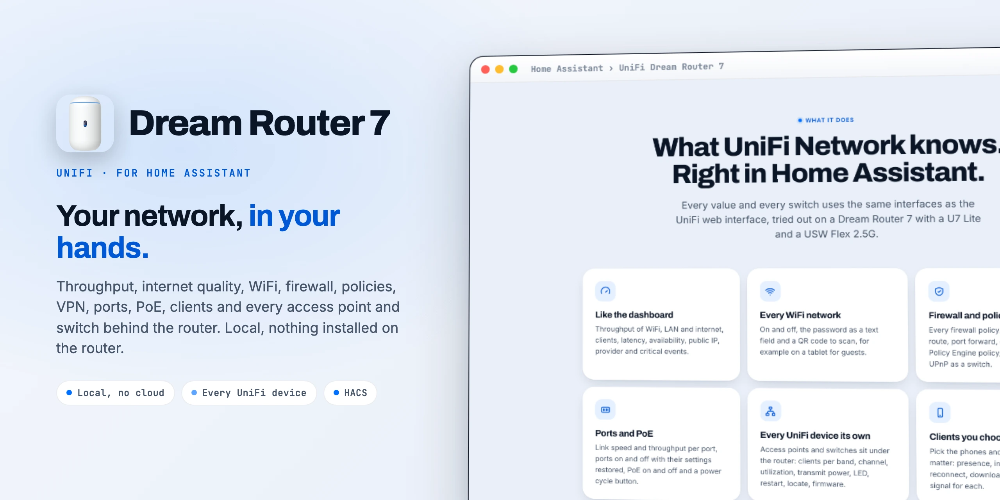

<div align="center">

<picture>
  <source media="(prefers-color-scheme: dark)" srcset="docs/images/readme-title-dark.webp" />
  
</picture>

<p>Your Dream Router 7 and every UniFi device behind it in Home Assistant.<br/>
WiFi, firewall, ports and clients, local, no cloud.</p>

[](https://github.com/SH1FT-W/unifi-dreamrouter7/releases/latest)
[](https://www.home-assistant.io)
[](https://hacs.xyz)
[](https://developers.home-assistant.io/docs/creating_integration_manifest/#iot-class)
[-006FFF?style=flat-square&labelColor=0B1526)](custom_components/udr7/quality_scale.yaml)
[](LICENSE)

<p><a href="https://sh1ft-w.github.io/unifi-dreamrouter7"><b>Website</b></a> &nbsp;·&nbsp; <a href="#features">Features</a> &nbsp;·&nbsp; <a href="#entities">Entities</a> &nbsp;·&nbsp; <a href="#installation">Install</a> &nbsp;·&nbsp; <a href="#security">Security</a> &nbsp;·&nbsp; <a href="#troubleshooting">Troubleshooting</a> &nbsp;·&nbsp; <a href="CHANGELOG.md">Changelog</a></p>

</div>

<br/>

UniFi Dream Router 7 brings a **UniFi Dream Router 7** and the access points and switches adopted to it into Home Assistant. It shows what the UniFi Network dashboard shows (throughput, clients, internet quality, speed tests) and lets you switch what you would otherwise switch in the UniFi Network app: WiFi networks and their password, firewall rules, policies, content filters, VPN, ports and PoE, the status LED with color, transmit power, client blocking and more. It talks to UniFi OS on your own network, the same way the web interface does. No cloud account, nothing installed on the router.

> [!NOTE]
> UniFi Dream Router 7 is an independent project. It is not affiliated with, endorsed by or sponsored by Ubiquiti Inc. UniFi, UniFi OS, UniFi Network and Dream Router are trademarks of Ubiquiti Inc.

<br/>

<a id="features"></a>
## Features

<!-- cards:features -->
<table>
<tr><td width="34" valign="top"><picture><source media="(prefers-color-scheme: dark)" srcset="docs/images/icons/speedometer-dark.svg"></picture></td><td width="46%" valign="top"><b>Like the dashboard</b><br>Throughput of WiFi, LAN and internet, clients, latency, availability, public IP, provider and critical events, as in UniFi Network.</td><td width="34" valign="top"><picture><source media="(prefers-color-scheme: dark)" srcset="docs/images/icons/wifi-dark.svg"></picture></td><td width="46%" valign="top"><b>Every WiFi network</b><br>On and off, the password as a text field and a QR code to scan, for example on a tablet for guests.</td></tr>
<tr><td width="34" valign="top"><picture><source media="(prefers-color-scheme: dark)" srcset="docs/images/icons/shield-check-dark.svg"></picture></td><td width="46%" valign="top"><b>Firewall and policies</b><br>Every firewall policy, traffic rule and route, port forward, content filter, Policy Engine policy and VPN server as a switch.</td><td width="34" valign="top"><picture><source media="(prefers-color-scheme: dark)" srcset="docs/images/icons/ethernet-dark.svg"></picture></td><td width="46%" valign="top"><b>Ports and PoE</b><br>Link speed and throughput per port, ports on and off with their settings restored, PoE on and off and a power cycle.</td></tr>
<tr><td width="34" valign="top"><picture><source media="(prefers-color-scheme: dark)" srcset="docs/images/icons/lan-dark.svg"></picture></td><td width="46%" valign="top"><b>Every UniFi device its own</b><br>Access points and switches sit under the router: clients per band, channel, utilization, transmit power, LED, restart, firmware.</td><td width="34" valign="top"><picture><source media="(prefers-color-scheme: dark)" srcset="docs/images/icons/cellphone-dark.svg"></picture></td><td width="46%" valign="top"><b>Clients you choose</b><br>Pick the phones that matter: presence, internet access, reconnect, download, upload and WiFi signal for each.</td></tr>
<tr><td width="34" valign="top"><picture><source media="(prefers-color-scheme: dark)" srcset="docs/images/icons/speedometer-medium-dark.svg"></picture></td><td width="46%" valign="top"><b>Speed tests</b><br>Download, upload and ping, a button, an automatic test on your interval and a comparison with the speed you pay for.</td><td width="34" valign="top"><picture><source media="(prefers-color-scheme: dark)" srcset="docs/images/icons/monitor-dark.svg"></picture></td><td width="46%" valign="top"><b>Display and night mode</b><br>The router's display with its brightness, every status LED and the night mode times, plus firmware and UniFi Network updates.</td></tr>
</table>
<!-- /cards:features -->

### What the official UniFi integration does not have

WiFi password as text, VPN servers and clients, content filters, UPnP, transmit power, network throughput and client counts, internet quality, speed test with automation and contract comparison, critical events, the display and night mode, guest authorization, the UniFi Network app update, locate, and a device tree with the access points and switches under the router. Client entities only for the clients you pick, instead of one for every client that ever connected.

<a id="entities"></a>
## Entities

<!-- cards:entities -->
<table>
<tr><td width="34" valign="top"><picture><source media="(prefers-color-scheme: dark)" srcset="docs/images/icons/chart-line-dark.svg"></picture></td><td width="46%" valign="top"><b>Network</b><br>wan_download, wan_upload, wifi_rx, wifi_tx, lan_rx, lan_tx, clients, internet_latency, wan_availability and critical_events.</td><td width="34" valign="top"><picture><source media="(prefers-color-scheme: dark)" srcset="docs/images/icons/speedometer-dark.svg"></picture></td><td width="46%" valign="top"><b>Internet and speed test</b><br>speedtest_download, speedtest_upload, speedtest_ping, isp, wan_ip, wan_ipv6, active_wan and the auto speed test switch.</td></tr>
<tr><td width="34" valign="top"><picture><source media="(prefers-color-scheme: dark)" srcset="docs/images/icons/router-wireless-dark.svg"></picture></td><td width="46%" valign="top"><b>Per device</b><br>cpu_load, memory_usage, cpu_temperature, connected_clients, online, firmware, restart, locate and status_led.</td><td width="34" valign="top"><picture><source media="(prefers-color-scheme: dark)" srcset="docs/images/icons/access-point-dark.svg"></picture></td><td width="46%" valign="top"><b>Per band and port</b><br>2_4_ghz_clients, channel, utilization, transmit_power as a select, port_1, port_1_poe, link speed and PoE power.</td></tr>
<tr><td width="34" valign="top"><picture><source media="(prefers-color-scheme: dark)" srcset="docs/images/icons/toggle-switch-dark.svg"></picture></td><td width="46%" valign="top"><b>Switches</b><br>wifi_*, firewall_*, traffic_rule_*, route_*, port_forward_*, content_filter_*, policy_*, vpn_* and upnp.</td><td width="34" valign="top"><picture><source media="(prefers-color-scheme: dark)" srcset="docs/images/icons/account-dark.svg"></picture></td><td width="46%" valign="top"><b>Per client</b><br>device_tracker, internet_access, reconnect, download, upload, wifi_signal and ip_address, for the clients you pick.</td></tr>
</table>
<!-- /cards:entities -->

All IDs start with the device name, for example `sensor.dream_router_7_cpu_load`, `switch.dream_router_7_wifi_guests` or `sensor.u7_lite_5_ghz_clients`. Network values keep the IDs of UniFi Network Plus (see migration), for example `sensor.unifi_wan_download`, `sensor.wifi_rx`, `button.unifi_run_speedtest`. Entity names are available in English and German.

Disabled by default: per-port receive and transmit, transmit power in dBm, connected since, Network version, WiFi password and WiFi QR code.

<details>
<summary>All entity IDs (example: a Dream Router 7 with a U7 Lite, a USW Flex 2.5G, two WiFi networks and two picked clients, English names)</summary>

```
binary_sensor.dream_router_7_lan_problem                binary_sensor.dream_router_7_online
binary_sensor.dream_router_7_overheating                binary_sensor.dream_router_7_wifi_problem
binary_sensor.u7_lite_online                            binary_sensor.unifi_active_wan_up
binary_sensor.unifi_speedtest_in_progress               binary_sensor.unifi_wan_internet
binary_sensor.usw_flex_2_5g_online                      binary_sensor.usw_flex_2_5g_overheating
button.dream_router_7_port_1_power_cycle                button.dream_router_7_restart
button.example_phone_reconnect                          button.tv_reconnect
button.u7_lite_restart                                  button.unifi_run_speedtest
button.usw_flex_2_5g_restart                            device_tracker.example_phone
device_tracker.tv                                       light.dream_router_7_display
light.dream_router_7_status_led                         light.u7_lite_status_led
light.usw_flex_2_5g_status_led                          select.dream_router_7_2_4_ghz_transmit_power
select.dream_router_7_5_ghz_transmit_power              select.dream_router_7_6_ghz_transmit_power
select.u7_lite_2_4_ghz_transmit_power                   select.u7_lite_5_ghz_transmit_power
sensor.dream_router_7_2_4_ghz_channel                   sensor.dream_router_7_2_4_ghz_channel_utilization
sensor.dream_router_7_2_4_ghz_clients                   sensor.dream_router_7_5_ghz_channel
sensor.dream_router_7_5_ghz_channel_utilization         sensor.dream_router_7_5_ghz_clients
sensor.dream_router_7_6_ghz_channel                     sensor.dream_router_7_6_ghz_channel_utilization
sensor.dream_router_7_6_ghz_clients                     sensor.dream_router_7_clients
sensor.dream_router_7_connected_clients                 sensor.dream_router_7_cpu_load
sensor.dream_router_7_cpu_temperature                   sensor.dream_router_7_critical_events_24_h
sensor.dream_router_7_guests                            sensor.dream_router_7_internet_availability
sensor.dream_router_7_internet_drops                    sensor.dream_router_7_internet_latency
sensor.dream_router_7_internet_provider                 sensor.dream_router_7_lan_clients
sensor.dream_router_7_memory_usage                      sensor.dream_router_7_poe_power
sensor.dream_router_7_port_1_link_speed                 sensor.dream_router_7_port_1_poe_power
sensor.dream_router_7_port_2_link_speed                 sensor.dream_router_7_port_3_link_speed
sensor.dream_router_7_port_4_link_speed                 sensor.dream_router_7_sfp_1_link_speed
sensor.dream_router_7_speed_test_server                 sensor.dream_router_7_started
sensor.dream_router_7_vpn_clients                       sensor.dream_router_7_wifi_clients
sensor.example_phone_download                           sensor.example_phone_ip_address
sensor.example_phone_upload                             sensor.example_phone_wifi_signal
sensor.lan_rx                                           sensor.lan_tx
sensor.tv_download                                      sensor.tv_ip_address
sensor.tv_upload                                        sensor.tv_wifi_signal
sensor.u7_lite_2_4_ghz_channel                          sensor.u7_lite_2_4_ghz_channel_utilization
sensor.u7_lite_2_4_ghz_clients                          sensor.u7_lite_5_ghz_channel
sensor.u7_lite_5_ghz_channel_utilization                sensor.u7_lite_5_ghz_clients
sensor.u7_lite_connected_clients                        sensor.u7_lite_cpu_load
sensor.u7_lite_memory_usage                             sensor.u7_lite_started
sensor.unifi_active_wan_name                            sensor.unifi_speedtest_download
sensor.unifi_speedtest_last_run                         sensor.unifi_speedtest_ping
sensor.unifi_speedtest_upload                           sensor.unifi_wan_download
sensor.unifi_wan_ipv4                                   sensor.unifi_wan_ipv6
sensor.unifi_wan_upload                                 sensor.usw_flex_2_5g_connected_clients
sensor.usw_flex_2_5g_cpu_load                           sensor.usw_flex_2_5g_memory_usage
sensor.usw_flex_2_5g_port_1_link_speed                  sensor.usw_flex_2_5g_port_2_link_speed
sensor.usw_flex_2_5g_port_5_link_speed                  sensor.usw_flex_2_5g_started
sensor.wifi_rx                                          sensor.wifi_tx
switch.dream_router_7_content_filter_ad_blocker         switch.dream_router_7_firewall_allow_example
switch.dream_router_7_firewall_block_example            switch.dream_router_7_locate
switch.dream_router_7_policy_internet_block             switch.dream_router_7_port_1
switch.dream_router_7_port_1_poe                        switch.dream_router_7_port_2
switch.dream_router_7_port_3                            switch.dream_router_7_port_4
switch.dream_router_7_port_forward_example_forward      switch.dream_router_7_route_example_route
switch.dream_router_7_upnp                              switch.dream_router_7_vpn_client_example_vpn
switch.dream_router_7_vpn_server_wireguard              switch.dream_router_7_wifi_example_guest
switch.dream_router_7_wifi_example_wifi                 switch.example_phone_internet_access
switch.tv_internet_access                               switch.u7_lite_locate
switch.unifi_wan_auto_speedtest                         switch.usw_flex_2_5g_locate
switch.usw_flex_2_5g_port_1                             switch.usw_flex_2_5g_port_2
time.dream_router_7_night_mode_end                      time.dream_router_7_night_mode_start
update.dream_router_7_firmware                          update.dream_router_7_unifi_network
update.u7_lite_firmware                                 update.usw_flex_2_5g_firmware
```

The network values keep the IDs of UniFi Network Plus (`sensor.unifi_wan_download`, `sensor.wifi_rx`, `button.unifi_run_speedtest` …); everything else starts with the device name.

</details>

<a id="installation"></a>
## Installation

### HACS (custom repository)

1. HACS, three dots, Custom repositories: `https://github.com/SH1FT-W/unifi-dreamrouter7`, type Integration.
2. Install **UniFi Dream Router 7** and restart Home Assistant.

### Manual

Copy `custom_components/udr7` into the `custom_components` folder of your Home Assistant configuration and restart.

## Setup

Settings, Devices & services: either **Discovered** (Dream Router found on its own) or **Add integration**, **UniFi Dream Router 7**.

| Field | Meaning |
|---|---|
| Host | Address of the router, `192.168.1.1` by default |
| Username, password | A **local** UniFi OS account with admin rights in UniFi Network. A UI account with two-factor login does not work. Display, night mode and the UniFi Network app update also need admin rights in UniFi OS (Super Admin). |
| Site | UniFi Network site, `default` unless you renamed it |
| Verify certificate | Off by default, see Security |

### Options

| Option | Meaning |
|---|---|
| Clients | Clients that get presence, internet access, reconnect and throughput |
| Away after | A client counts as home this long after its last contact (phones sleep on WiFi), 300 s by default |
| Automatic speed test every | Interval of the automatic speed test switch, 60 minutes by default |
| Contracted download, upload | The speed you pay for; 0 = no comparison |
| Tolerance | Deviation that still counts as "as expected", 10 % by default |
| Verify certificate | See Security |

## Internet access

Everything runs locally. Only the product pictures come from Ubiquiti's public device catalog (`static.ui.com`, the same source the UniFi interface uses): Home Assistant fetches the catalog at most once a week, your browser loads the pictures from there. Without internet the entities simply have no picture.

<a id="security"></a>
## Security

UniFi OS uses a self-signed certificate. At setup the integration remembers the certificate the router shows and afterwards sends the login only to a router with exactly that certificate. If it changes (factory reset, new UniFi OS install), a repair under Settings, Repairs shows the old and the new fingerprint and asks before it accepts the new one. Turn on **Verify certificate** only if the router has a certificate from a trusted authority. Diagnostics downloads contain no address, login, MAC, IP, serial number, name or WiFi password.

## Data updates

Network values every 15 seconds, devices and clients every 30 seconds, settings (WiFi, rules, filters, VPN) every minute, firmware and app versions every 5 minutes. After every command everything is fetched again right away. If the router is not reachable, all entities become unavailable and come back on their own.

## Supported devices

Developed and tested on a **UniFi Dream Router 7** (UniFi OS 5.1, UniFi Network 10.6) with a U7 Lite access point and a USW Flex 2.5G switch. Other UniFi access points and switches adopted to the router work the same way. Other consoles (Dream Machine, Cloud Gateway) will likely work as well, but are not tested and are not discovered on their own.

## Migration

From **UniFi Network Plus**: remove UniFi Network Plus first, then set up this integration. The network values take over the same entity IDs, so dashboards, history and statistics continue.

From the **official UniFi integration**: both can run side by side. Entity IDs differ (for example `switch.dream_router_7_wifi_home` instead of `switch.home`), so update automations and dashboards, then remove the official integration.

## Examples

```yaml
# Guest WiFi only while guests are here
automation:
  - triggers:
      - trigger: state
        entity_id: input_boolean.guests
    actions:
      - action: >-
          switch.turn_{{ trigger.to_state.state }}
        target:
          entity_id: switch.dream_router_7_wifi_guests

# Status LED off at night
  - triggers:
      - trigger: time
        at: "22:00:00"
    actions:
      - action: light.turn_off
        target:
          entity_id:
            - light.dream_router_7_status_led
            - light.u7_lite_status_led

# Internet off for the kids' devices at bedtime (a Policy Engine policy in UniFi Network)
  - triggers:
      - trigger: time
        at: "21:00:00"
    actions:
      - action: switch.turn_on
        target:
          entity_id: switch.dream_router_7_policy_kids_bedtime
```

Block a single client by MAC without picking it in the options:

```yaml
action: udr7.block_client
data:
  mac: "aa:bb:cc:dd:ee:ff"
```

## Actions

| Action | Fields |
|---|---|
| `udr7.block_client`, `udr7.unblock_client` | `mac`, optional `config_entry_id` |
| `udr7.reconnect_client` | `mac`, optional `config_entry_id` |
| `udr7.authorize_guest` | `mac`, optional `minutes`, optional `config_entry_id` |
| `udr7.unauthorize_guest` | `mac`, optional `config_entry_id` |

## Known limitations

- Local accounts only; UI accounts with two-factor login are not supported.
- Ports to the internet (WAN, SFP+ on the Dream Router) and the uplink of a switch have no on/off switch, so you cannot cut yourself off.
- A port is turned off the way the official integration does it (port security without allowed devices); UniFi Network then rewrites the port settings. The integration remembers the settings from before and restores them exactly when you turn the port back on. A port turned off in UniFi Network itself comes back with its default settings (all networks).
- Transmit power "custom" (fixed dBm) is only shown as unknown; set it in UniFi Network.
- Values are polled, not pushed; presence changes show within 30 seconds plus the away time.
- Predefined zone firewall rules cannot be switched (UniFi does not allow it either).

<a id="troubleshooting"></a>
## Troubleshooting

| Problem | What to do |
|---|---|
| "Username or password is wrong" | Use a local UniFi OS account, not your UI account. |
| "No access to UniFi Network" | Give the account admin rights in UniFi Network. |
| "No admin rights" for display, night mode or app update | These are UniFi OS settings; give the account Super Admin. |
| Certificate changed | Settings, Repairs: compare the fingerprints and accept the new one if you know why it changed. |
| A command fails | The error message names what UniFi answered; most often missing rights. Download diagnostics for details. |

## Removal

Settings, Devices & services, UniFi Dream Router 7, three dots, Delete. Then remove it in HACS (or delete `custom_components/udr7`) and restart. Nothing is left on the router.

<details>
<summary><b>Development</b></summary>
<br/>

```bash
python -m pytest -q -p no:logging        # simulated router in tests/conftest.py, no real router needed
uvx ruff check . && uvx ruff format --check .
uvx mypy@2.3.1 --python-executable <venv>/bin/python
python tools/pruefe-uebersetzungen.py    # strings.json against translations/*.json
```

Install the test requirements into a virtual environment with `pip install -r requirements_test.txt`. The same checks run on GitHub Actions for every push and pull request, plus HACS validation and hassfest. Notes on the UniFi OS and UniFi Network interfaces are in [`CLAUDE.md`](CLAUDE.md) (German).

</details>

<details>
<summary><b>Versions</b></summary>
<br/>

UniFi Dream Router 7 uses calendar versions **`YY.M.N`**: year, month, and the number of the release within that month. `26.10.1` is the first release of October 2026. Tags, release titles and the version badge are just the number, without a leading "v".

</details>

## License

[Apache License 2.0](LICENSE), Copyright 2026 SH1FT-W.

<br/>

<div align="center">
  <sub>A <a href="https://sh1ft-w.github.io"><b>SH1FT-W</b></a> project &nbsp;·&nbsp; <a href="https://sh1ft-w.github.io/unifi-unas">UniFi UNAS</a> &nbsp;·&nbsp; <a href="https://sh1ft-w.github.io/casora">Casora</a> &nbsp;·&nbsp; <a href="https://sh1ft-w.github.io/flode">FLODE</a> &nbsp;·&nbsp; <a href="https://sh1ft-w.github.io/pulse">Pulse</a> &nbsp;·&nbsp; Built with <a href="https://claude.ai">Claude</a></sub>
</div>
