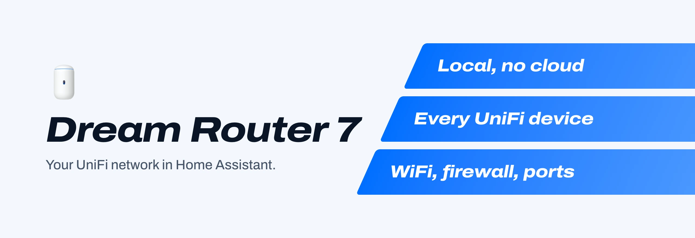

<div align="center">

<picture>
  <source media="(prefers-color-scheme: dark)" srcset="docs/images/readme-title-dark.webp" />
  
</picture>

[](https://github.com/SH1FT-W/unifi-dreamrouter7/releases/latest)
[](https://www.home-assistant.io)
[](https://hacs.xyz)

<a href="https://sh1ft-w.github.io/unifi-dreamrouter7"><b>Website</b></a>&emsp;<a href="#install">Install</a>&emsp;<a href="#set-up">Set up</a>&emsp;<a href="#entities">Entities</a>&emsp;<a href="CHANGELOG.md">Changelog</a>

</div>

<br/>

Your UniFi Dream Router 7 and every access point and switch behind it in Home Assistant: **what the UniFi Network dashboard shows, and what you would otherwise switch in the app.** WiFi networks and their password, firewall rules, policies, content filters, VPN, ports and PoE, LEDs, transmit power and the clients you pick. Over your own network, no cloud account, nothing installed on the router.

It is developed and tested on a Dream Router 7 with a U7 Lite and a USW Flex 2.5G. Other access points and switches adopted to the router work the same way. Other consoles (Dream Machine, Cloud Gateway) will likely work, but are untested and not discovered on their own.

## Compared with the official UniFi integration

|  | Official UniFi | Dream Router 7 |
|:--|:--:|:--:|
| WiFi networks on and off | ✓ | ✓ |
| Client entities | every client that ever connected | only the ones you pick |
| Set the WiFi password | | ✓ |
| VPN servers and clients, content filters, UPnP | | ✓ |
| Throughput, client counts, internet quality, critical events | | ✓ |
| Speed test with automation and contract comparison | | ✓ |
| Transmit power, locate, display and night mode | | ✓ |
| Guest authorization, UniFi Network app update | | ✓ |
| Access points and switches as devices under the router | | ✓ |

Both can run side by side while you move automations over. Coming from **UniFi Network Plus**, remove it first: the network values take over its entity IDs, so dashboards, history and statistics continue.

**New in 26.11:** an event for every new device on the network, internet outages today with the last one, and a write-only WiFi password. Every change is in the [changelog](CHANGELOG.md).

<a id="install"></a>
## Install

[](https://my.home-assistant.io/redirect/hacs_repository/?owner=SH1FT-W&repository=unifi-dreamrouter7&category=integration)

Search for **UniFi Dream Router 7** under **Settings > Marketplace** (called HACS before Home Assistant 2026.11), download it and restart Home Assistant.

<details>
<summary>Install by hand</summary>

1. Download the [latest release](https://github.com/SH1FT-W/unifi-dreamrouter7/releases/latest).
2. Copy `custom_components/udr7` into `/config/custom_components/` and restart Home Assistant.

</details>

<a id="set-up"></a>
## Set up

You need a **local** UniFi OS account with admin rights in UniFi Network. UI accounts with two-factor login do not work. Display, night mode and the UniFi Network app update also need admin rights in UniFi OS (Super Admin).

1. **Add the router.** It usually shows up under **Settings > Devices & services > Discovered**. If not, choose **Add integration > UniFi Dream Router 7**; the address is `192.168.1.1` by default.
2. **Enter username and password.** Site stays `default` unless you renamed it. Leave **Verify certificate** off unless the router has a certificate from a trusted authority.
3. **Pick your clients** under **Configure**: the phones and devices that should get presence, internet access, reconnect and throughput.

<details>
<summary>All options</summary>

| Option | Meaning |
|:--|:--|
| Clients | Clients that get presence, internet access, reconnect and throughput |
| Away after | A client counts as home this long after its last contact (phones sleep on WiFi), 300 s by default |
| Automatic speed test every | Interval of the automatic speed test switch, 60 minutes by default |
| Contracted download, upload | The speed you pay for; 0 = no comparison |
| Tolerance | Deviation that still counts as "as expected", 10 % by default |
| New devices also on LAN | Off: "New device connected" only for WiFi devices. On: also for devices connected by cable |
| Verify certificate | See [Your data](#your-data) |

</details>

<a id="entities"></a>
## Entities

IDs for a router named "Dream Router 7". The network values keep the IDs of UniFi Network Plus. Names are in English and German. New WiFi networks and rules appear without a restart.

| Entity | Shows |
|:--|:--|
| `sensor.unifi_wan_download`, `_upload`, `sensor.wifi_rx`, `_tx`, `sensor.lan_rx`, `_tx` | Throughput, as on the Network dashboard |
| `binary_sensor.unifi_wan_internet`, `sensor.dream_router_7_internet_latency`, `_internet_availability` | Internet quality. Latency has the 24 hour `average` |
| `sensor.dream_router_7_internet_outages_today`, `_last_internet_outage` | Outages since midnight, the last one with `end` and `duration_seconds`. Kept across restarts |
| `sensor.unifi_speedtest_download`, `_upload`, `_ping`, `button.unifi_run_speedtest`, `switch.unifi_wan_auto_speedtest` | Speed test, by hand or on your interval |
| `switch.dream_router_7_wifi_<network>` | One per WiFi network |
| `switch.dream_router_7_firewall_<rule>`, `_policy_`, `_content_filter_`, `_vpn_server_`, `_vpn_client_`, `_port_forward_`, `_route_`, `_upnp` | One switch per rule, policy, filter and VPN |
| `switch.dream_router_7_port_1`, `_port_1_poe`, `button.dream_router_7_port_1_power_cycle` | Ports and PoE, also on switches |
| `device_tracker.<client>`, `switch.<client>_internet_access`, `button.<client>_reconnect` | For the clients you pick |
| `event.dream_router_7_new_device_connected` | The first time an unknown MAC address connects |
| `light.dream_router_7_status_led`, `light.dream_router_7_display`, `time.dream_router_7_night_mode_start`, `_end` | LED (with color on devices with an LED ring), display brightness, night mode |
| `update.dream_router_7_firmware`, `update.dream_router_7_unifi_network` | UniFi OS and the UniFi Network app, also firmware for every device |

<details>
<summary>More entities</summary>

| Entity | Shows |
|:--|:--|
| `sensor.dream_router_7_cpu_load`, `_memory_usage`, `_cpu_temperature`, `_started`, `_connected_clients` | Per device, also for access points and switches |
| `binary_sensor.dream_router_7_online`, `_overheating`, `button.dream_router_7_restart`, `switch.dream_router_7_locate` | Per device |
| `sensor.dream_router_7_5_ghz_clients`, `_5_ghz_channel`, `_5_ghz_channel_utilization`, `select.dream_router_7_5_ghz_transmit_power` | Per band |
| `sensor.dream_router_7_port_1_link_speed`, `_port_1_poe_power`, `_poe_power` | Per port |
| `sensor.dream_router_7_clients`, `_wifi_clients`, `_lan_clients`, `_guests`, `_vpn_clients` | Client counts. VPN clients has the totals of the VPN servers |
| `sensor.dream_router_7_internet_provider`, `_internet_drops`, `_critical_events_24_h`, `_speed_test_server` | |
| `sensor.unifi_wan_ipv4`, `_ipv6`, `sensor.unifi_active_wan_name`, `binary_sensor.unifi_active_wan_up` | WAN |
| `binary_sensor.unifi_speedtest_in_progress`, `sensor.unifi_speedtest_last_run` | Speed test state |
| `binary_sensor.dream_router_7_wifi_problem`, `_lan_problem` | Problems as UniFi reports them |
| `sensor.<client>_download`, `_upload`, `_wifi_signal`, `_ip_address` | For the clients you pick |
| `switch.dream_router_7_traffic_rule_<name>`, `_qos_<name>` | Traffic and QoS rules |

Disabled by default: WiFi password (write-only, it never shows the current one) and WiFi QR code, per-port receive and transmit, transmit power in dBm, connected since, Network version.

**New device connected** carries `mac`, `name`, `hostname`, `manufacturer`, `ssid`, `ip`, `network`, `wired`, `random_mac` and `time`. Devices known at the first start count as seen. Devices with a private address that changes (for example "Rotating" on iPhone) show up again with every new address; `random_mac` tells them apart.

</details>

<details>
<summary>Actions</summary>

| Action | Fields |
|:--|:--|
| `udr7.block_client`, `udr7.unblock_client` | `mac`, optional `config_entry_id` |
| `udr7.reconnect_client` | `mac`, optional `config_entry_id` |
| `udr7.authorize_guest` | `mac`, optional `minutes`, optional `config_entry_id` |
| `udr7.unauthorize_guest` | `mac`, optional `config_entry_id` |

They work for any client, also one you did not pick in the options.

</details>

## Examples

Guest WiFi only while guests are here:

```yaml
triggers:
  - trigger: state
    entity_id: input_boolean.guests
actions:
  - action: >-
      switch.turn_{{ trigger.to_state.state }}
    target:
      entity_id: switch.dream_router_7_wifi_guests
```

<details>
<summary>Status LEDs off at night</summary>

```yaml
triggers:
  - trigger: time
    at: "22:00:00"
actions:
  - action: light.turn_off
    target:
      entity_id:
        - light.dream_router_7_status_led
        - light.u7_lite_status_led
```

</details>

<details>
<summary>Internet off for the kids' devices at bedtime (a Policy Engine policy)</summary>

```yaml
triggers:
  - trigger: time
    at: "21:00:00"
actions:
  - action: switch.turn_on
    target:
      entity_id: switch.dream_router_7_policy_kids_bedtime
```

</details>

<a id="your-data"></a>
## Your data

- **The login only goes to your router.** UniFi OS uses a self-signed certificate, so the integration remembers the one the router shows at setup and talks to nothing else. If it changes, **Settings > Repairs** shows the old and the new fingerprint. Accept it after a factory reset or a new UniFi OS install; if you changed nothing, do not.
- **The only internet access** is the product pictures from Ubiquiti's public device catalog (`static.ui.com`), fetched at most once a week. Without internet the entities simply have no picture.
- **Diagnostics leave out** address, login, MAC and IP addresses, serial numbers, names and WiFi passwords.

## Good to know

- Ports to the internet and the uplink of a switch have no on/off switch, so you cannot cut yourself off there. Predefined zone firewall rules cannot be switched, as in UniFi.
- Turning a port off works like the official integration (port security without allowed devices). The integration remembers the port's settings and restores them exactly; a port turned off in UniFi Network itself comes back with its defaults.
- Values are polled, not pushed: presence changes show within 30 seconds plus the away time. Internet outages shorter than 15 seconds may be missed.
- Transmit power "custom" (fixed dBm) shows as unknown; set it in UniFi Network.

<details>
<summary>Troubleshooting</summary>

- **"Username or password is wrong".** Use a local UniFi OS account, not your UI account.
- **"No access to UniFi Network".** Give the account admin rights in UniFi Network.
- **"No admin rights" for display, night mode or app update.** These are UniFi OS settings; give the account Super Admin.
- **A command fails.** The message names what UniFi answered, most often missing rights.
- **All entities unavailable.** The router does not answer; they come back on their own. A new address: **three dots > Reconfigure**.

When you open an [issue](https://github.com/SH1FT-W/unifi-dreamrouter7/issues), attach the diagnostics (**Settings > Devices & services > UniFi Dream Router 7 > three dots > Download diagnostics**).

</details>

<details>
<summary>Remove</summary>

1. **Settings > Devices & services > UniFi Dream Router 7 > three dots > Delete**.
2. Remove the repository in the Marketplace (or delete `/config/custom_components/udr7`) and restart Home Assistant.

Nothing is left on the router.

</details>

<details>
<summary>How it works</summary>

| What | How often |
|:--|:--|
| Network values | every 15 seconds |
| Devices and clients | every 30 seconds |
| Settings (WiFi, rules, filters, VPN) | every minute |
| Firmware and app versions | every 5 minutes |
| After a command | everything right away |

Everything goes over HTTPS to UniFi OS and the UniFi Network app, using the interfaces of their web interface. Home Assistant's DHCP discovery finds the router. Notes on the interfaces are in [`CLAUDE.md`](CLAUDE.md) (German).

</details>

<details>
<summary>Development</summary>

```bash
python -m pytest -q -p no:logging        # simulated router in tests/conftest.py, no real router needed
uvx ruff check . && uvx ruff format --check .
uvx mypy@2.3.1 --python-executable <venv>/bin/python
python tools/pruefe-uebersetzungen.py    # strings.json against translations/*.json
```

Test requirements: `pip install -r requirements_test.txt`. GitHub Actions runs the same checks plus HACS validation and hassfest. Quality scale: platinum, [self-assessed](custom_components/udr7/quality_scale.yaml).

</details>

## License

[Apache License 2.0](LICENSE). Copyright 2026 SH1FT-W.

<sub>UniFi Dream Router 7 is an independent project, not affiliated with, endorsed or sponsored by Ubiquiti Inc. UniFi, UniFi OS, UniFi Network and Dream Router are trademarks of Ubiquiti Inc.</sub>
