<div align="center">



# UniFi Dream Router 7 for Home Assistant

<p>Your Dream Router 7, its WiFi, firewall, clients and every UniFi device behind it.<br/>
Local, no cloud, more control than the official UniFi integration.</p>

[](https://github.com/SH1FT-W/unifi-dreamrouter7/releases/latest)
[](https://www.home-assistant.io)
[](https://hacs.xyz)
[](https://developers.home-assistant.io/docs/creating_integration_manifest/#iot-class)
[-006FFF?style=flat-square&labelColor=0B1526)](custom_components/udr7/quality_scale.yaml)
[](LICENSE)

</div>

UniFi Dream Router 7 brings a **UniFi Dream Router 7** and the access points and switches adopted to it into Home Assistant. It shows what the UniFi Network dashboard shows (throughput, clients, internet quality, speed tests) and lets you switch what you would otherwise switch in the UniFi Network app: WiFi networks and their password, firewall rules, policies, content filters, VPN, ports and PoE, the status LED with color, transmit power, client blocking and more. It talks to UniFi OS on your own network, the same way the web interface does. No cloud account, nothing installed on the router.

> [!NOTE]
> UniFi Dream Router 7 is an independent project. It is not affiliated with, endorsed by or sponsored by Ubiquiti Inc. UniFi, UniFi OS, UniFi Network and Dream Router are trademarks of Ubiquiti Inc.

## Features

**Network, like the dashboard**
- Throughput of WiFi, LAN and the internet connection, upload and download
- Clients: total, WiFi, LAN, guests and VPN
- Internet connected, latency, availability and drops, active WAN, public IPv4 and IPv6, internet provider
- Speed test: download, upload, ping, last run and server, a button, an automatic speed test and a comparison with the speed you pay for
- WiFi problem and LAN problem, critical events of the last 24 hours with the latest one

**Control**
- Every WiFi network: on/off, password (text entity), QR code (image entity, for a guest tablet)
- Every firewall policy, traffic rule, traffic route, port forward, content filter (ad blocker), Policy Engine policy (for example an internet block for a group of clients), VPN server and VPN client: on/off
- UPnP on/off
- The router's display as a light (on/off and brightness; a color only on consoles with a bezel, not on the Dream Router 7) and the night mode start and end
- Client actions for any client by MAC: block, unblock, reconnect, authorize and revoke a guest

**Every UniFi device its own device** (the Dream Router itself, and each access point and switch under it)
- CPU load, memory, CPU temperature, started, connected clients, online, overheating
- Status LED as a light, with color and brightness only on devices with an LED ring (the Dream Router 7, U7 Lite and USW Flex 2.5G have none: on/off)
- Per WiFi band: clients, channel, channel utilization, transmit power (select: auto, high, medium, low)
- Per port: link speed, receive and transmit, port on/off, PoE on/off, PoE power and a PoE power cycle button
- Restart, locate (LED blinks), firmware update with progress; the Dream Router's firmware is UniFi OS
- The product picture of each device on its firmware update and online entities (Home Assistant shows the integration logo on every device page, so this is where the device's own picture appears)
- UniFi Network app update

**Clients you choose** (in the options) get a device of their own with presence (device tracker), internet access (block switch), reconnect, download, upload, WiFi signal and IP address.

**Local and discovered:** talks only to the router on your network. Home Assistant finds the router on its own (it sees it as `unifi` in its network neighbourhood, within an hour after a restart at the latest) and shows it under Settings, Devices & services, Discovered.

### What the official UniFi integration does not have

WiFi password as text, VPN servers and clients, content filters, UPnP, transmit power, network throughput and client counts, internet quality, speed test with automation and contract comparison, critical events, the display and night mode, guest authorization, the UniFi Network app update, locate, and a device tree with the access points and switches under the router. Client entities only for the clients you pick, instead of one for every client that ever connected.

## Entities

All IDs start with the device name, for example `sensor.dream_router_7_cpu_load`, `switch.dream_router_7_wifi_guests` or `sensor.u7_lite_5_ghz_clients`. Network values keep the IDs of UniFi Network Plus (see migration), for example `sensor.unifi_wan_download`, `sensor.wifi_rx`, `button.unifi_run_speedtest`. Entity names are available in English and German.

Disabled by default: per-port receive and transmit, transmit power in dBm, connected since, Network version, WiFi password and WiFi QR code.

## Installation

### HACS (custom repository)

1. HACS, three dots, Custom repositories: `https://github.com/SH1FT-W/unifi-dreamrouter7`, type Integration.
2. Install **UniFi Dream Router 7** and restart Home Assistant.

### Manual

Copy `custom_components/udr7` into the `custom_components` folder of your Home Assistant configuration and restart.

## Setup

Settings, Devices & services: either **Discovered** (Dream Router found on its own) or **Add integration**, **UniFi Dream Router 7**.

| Field | Meaning |
|---|---|
| Host | Address of the router, `192.168.1.1` by default |
| Username, password | A **local** UniFi OS account with admin rights in UniFi Network. A UI account with two-factor login does not work. Display, night mode and the UniFi Network app update also need admin rights in UniFi OS (Super Admin). |
| Site | UniFi Network site, `default` unless you renamed it |
| Verify certificate | Off by default, see Security |

### Options

| Option | Meaning |
|---|---|
| Clients | Clients that get presence, internet access, reconnect and throughput |
| Away after | A client counts as home this long after its last contact (phones sleep on WiFi), 300 s by default |
| Automatic speed test every | Interval of the automatic speed test switch, 60 minutes by default |
| Contracted download, upload | The speed you pay for; 0 = no comparison |
| Tolerance | Deviation that still counts as "as expected", 10 % by default |
| Verify certificate | See Security |

## Internet access

Everything runs locally. Only the product pictures come from Ubiquiti's public device catalog (`static.ui.com`, the same source the UniFi interface uses): Home Assistant fetches the catalog at most once a week, your browser loads the pictures from there. Without internet the entities simply have no picture.

## Security

UniFi OS uses a self-signed certificate. At setup the integration remembers the certificate the router shows and afterwards sends the login only to a router with exactly that certificate. If it changes (factory reset, new UniFi OS install), a repair under Settings, Repairs shows the old and the new fingerprint and asks before it accepts the new one. Turn on **Verify certificate** only if the router has a certificate from a trusted authority. Diagnostics downloads contain no address, login, MAC, IP, serial number, name or WiFi password.

## Data updates

Network values every 15 seconds, devices and clients every 30 seconds, settings (WiFi, rules, filters, VPN) every minute, firmware and app versions every 5 minutes. After every command everything is fetched again right away. If the router is not reachable, all entities become unavailable and come back on their own.

## Supported devices

Developed and tested on a **UniFi Dream Router 7** (UniFi OS 5.1, UniFi Network 10.6) with a U7 Lite access point and a USW Flex 2.5G switch. Other UniFi access points and switches adopted to the router work the same way. Other consoles (Dream Machine, Cloud Gateway) will likely work as well, but are not tested and are not discovered on their own.

## Migration

From **UniFi Network Plus**: remove UniFi Network Plus first, then set up this integration. The network values take over the same entity IDs, so dashboards, history and statistics continue.

From the **official UniFi integration**: both can run side by side. Entity IDs differ (for example `switch.dream_router_7_wifi_home` instead of `switch.home`), so update automations and dashboards, then remove the official integration.

## Examples

```yaml
# Guest WiFi only while guests are here
automation:
  - triggers:
      - trigger: state
        entity_id: input_boolean.guests
    actions:
      - action: >-
          switch.turn_{{ trigger.to_state.state }}
        target:
          entity_id: switch.dream_router_7_wifi_guests

# Status LED off at night
  - triggers:
      - trigger: time
        at: "22:00:00"
    actions:
      - action: light.turn_off
        target:
          entity_id:
            - light.dream_router_7_status_led
            - light.u7_lite_status_led

# Internet off for the kids' devices at bedtime (a Policy Engine policy in UniFi Network)
  - triggers:
      - trigger: time
        at: "21:00:00"
    actions:
      - action: switch.turn_on
        target:
          entity_id: switch.dream_router_7_policy_kids_bedtime
```

Block a single client by MAC without picking it in the options:

```yaml
action: udr7.block_client
data:
  mac: "aa:bb:cc:dd:ee:ff"
```

## Actions

| Action | Fields |
|---|---|
| `udr7.block_client`, `udr7.unblock_client` | `mac`, optional `config_entry_id` |
| `udr7.reconnect_client` | `mac`, optional `config_entry_id` |
| `udr7.authorize_guest` | `mac`, optional `minutes`, optional `config_entry_id` |
| `udr7.unauthorize_guest` | `mac`, optional `config_entry_id` |

## Known limitations

- Local accounts only; UI accounts with two-factor login are not supported.
- Ports to the internet (WAN, SFP+ on the Dream Router) and the uplink of a switch have no on/off switch, so you cannot cut yourself off.
- A port is turned off the way the official integration does it (port security without allowed devices); UniFi Network then rewrites the port settings. The integration remembers the settings from before and restores them exactly when you turn the port back on. A port turned off in UniFi Network itself comes back with its default settings (all networks).
- Transmit power "custom" (fixed dBm) is only shown as unknown; set it in UniFi Network.
- Values are polled, not pushed; presence changes show within 30 seconds plus the away time.
- Predefined zone firewall rules cannot be switched (UniFi does not allow it either).

## Troubleshooting

| Problem | What to do |
|---|---|
| "Username or password is wrong" | Use a local UniFi OS account, not your UI account. |
| "No access to UniFi Network" | Give the account admin rights in UniFi Network. |
| "No admin rights" for display, night mode or app update | These are UniFi OS settings; give the account Super Admin. |
| Certificate changed | Settings, Repairs: compare the fingerprints and accept the new one if you know why it changed. |
| A command fails | The error message names what UniFi answered; most often missing rights. Download diagnostics for details. |

## Removal

Settings, Devices & services, UniFi Dream Router 7, three dots, Delete. Then remove it in HACS (or delete `custom_components/udr7`) and restart. Nothing is left on the router.

## License

Apache License 2.0, see [LICENSE](LICENSE) and [NOTICE](NOTICE).
